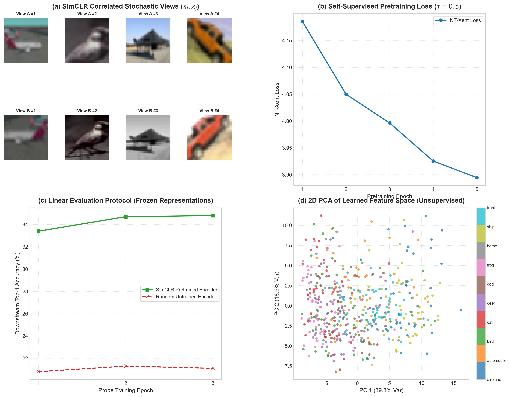

# SimCLR: Self-Supervised Contrastive Learning on CIFAR-10

[](https://www.python.org/downloads/)
[](https://pytorch.org/)
[](https://pytorch.org/vision/stable/index.html)
[](LICENSE)
[](https://github.com/GideonMwiti)

A production-grade implementation of **SimCLR (A Simple Framework for Contrastive Learning of Visual Representations)** by Chen et al. (ICML 2020) on **CIFAR-10** using PyTorch. The framework learns expressive, linearly separable visual representations **completely without human annotations** by maximizing agreement between stochastically augmented views of the same image via **Normalized Temperature-scaled Cross Entropy (NT-Xent)** loss, a **non-linear projection head**, and **hyperspherical $L_2$ metric embeddings**.

---

## Visual Diagnostic & Representation Dashboard

The self-supervised pipeline pretrains the convolutional encoder, evaluates the learned feature representations via a downstream frozen linear probe, and visualizes the unsupervised representation manifold in 2D space:



*Figure 1: (a) Stochastic multi-view augmentation pairs ($x_i, x_j$) combining random resized crops, horizontal flips, and aggressive color jittering; (b) Self-supervised NT-Xent pretraining loss trajectory ($\tau = 0.5$); (c) Downstream linear evaluation protocol comparing the SimCLR frozen encoder against an untrained random baseline; (d) 2D PCA projection of the unsupervised 256-D representation space colored by ground-truth classes.*

---

## Theoretical Foundations

Supervised learning requires costly human annotations and risks learning brittle features tied strictly to predefined label categories. **Self-Supervised Contrastive Learning** circumvents manual labels by formulating an instance-level pretext task: **treat each image instance as its own distinct class**, maximizing agreement between differently augmented views of the same image (positive pairs) while repelling all other images in the batch (negative pairs).

```
Input Image (x)
   ├───► Stochastic Augmentation t  ──► View 1 (x_i) ──► [ Encoder f(.) ] ──► Repr h_i ──► [ Proj Head g(.) ] ──► z_i ──┐
   │                                                                                                                       ├──► NT-Xent Loss
   └───► Stochastic Augmentation t' ──► View 2 (x_j) ──► [ Encoder f(.) ] ──► Repr h_j ──► [ Proj Head g(.) ] ──► z_j ──┘
                                                                ▲
                                                    Frozen for Linear Probe
```

---

### 1. The SimCLR Framework Components

1. **Stochastic Data Augmentation Module**: For each unlabeled sample $x$, generates two correlated views $(\tilde{x}_i, \tilde{x}_j)$. Chen et al. proved that **composition of augmentations** is critical:
   - Random Resized Crop ($32 \times 32$, scale $0.2\text{–}1.0$)
   - Random Horizontal Flip ($p=0.5$)
   - Random Color Jitter (brightness $0.4$, contrast $0.4$, saturation $0.4$, hue $0.1$, $p=0.8$)
   - Random Grayscale ($p=0.2$)
   *Without color jitter, models exploit color histograms as a shortcut, bypassing semantic geometric features.*

2. **Base Encoder $f(\cdot)$**: A convolutional network mapping an augmented view $\tilde{x}$ to a representation vector $\mathbf{h} = f(\tilde{x}) \in \mathbb{R}^d$. We employ a 4-stage residual architecture (`MiniResNet`, $d=256$).

3. **Non-Linear Projection Head $g(\cdot)$**: A 2-layer MLP with Batch Normalization and ReLU mapping $\mathbf{h}$ to a lower-dimensional projection space $\mathbf{z} = g(\mathbf{h}) \in \mathbb{R}^k$ ($k=64$):
   $$\mathbf{z} = \mathbf{W}^{(2)} \cdot \text{ReLU}\left( \text{BatchNorm}\left( \mathbf{W}^{(1)} \mathbf{h} \right) \right)$$
   **Why the non-linear projection head is crucial**: Chen et al. demonstrated that $g(\cdot)$ acts as a lossy information filter. Contrastive loss forces $\mathbf{z}$ to become invariant to the specific data augmentations applied (e.g. color distribution). By computing contrastive loss on $\mathbf{z}$, the representation $\mathbf{h}$ remains free to retain rich color and spatial structure vital for downstream transfer tasks.

4. **Hyperspherical $L_2$ Normalization**: Projections are projected onto the unit hypersphere $\mathbb{S}^{k-1}$:
   $$\mathbf{z}_i \leftarrow \frac{\mathbf{z}_i}{\| \mathbf{z}_i \|_2}, \quad \|\mathbf{z}_i\|_2 = 1.0$$
   This bounds all pairwise inner products to standard cosine similarity:
   $$\text{sim}(\mathbf{u}, \mathbf{v}) = \frac{\mathbf{u}^T \mathbf{v}}{\|\mathbf{u}\|_2 \|\mathbf{v}\|_2} = \mathbf{u}^T \mathbf{v} \in [-1, 1]$$

---

### 2. Normalized Temperature-scaled Cross Entropy (NT-Xent)

Given a mini-batch of $N$ images, $2N$ augmented views are processed concurrently. For a positive pair $(\mathbf{z}_i, \mathbf{z}_j)$ originating from the same source image, the remaining $2(N-1)$ augmented representations in the batch are treated as negative examples.

The contrastive loss for positive pair $(i, j)$ with temperature hyperparameter $\tau > 0$ is defined as:

$$\ell_{i, j} = -\log \frac{\exp\left( \text{sim}(\mathbf{z}_i, \mathbf{z}_j) / \tau \right)}{\sum_{k=1}^{2N} \mathbf{1}_{[k \ne i]} \exp\left( \text{sim}(\mathbf{z}_i, \mathbf{z}_k) / \tau \right)}$$

Total batch loss is computed across all $2N$ positive pairs:

$$\mathcal{L}_{\text{NT-Xent}} = \frac{1}{2N} \sum_{k=1}^N \left( \ell_{2k-1, 2k} + \ell_{2k, 2k-1} \right)$$

#### Role of Temperature ($\tau = 0.5$):
The temperature parameter $\tau$ scales cosine logits:
- Smaller $\tau$ forces the softmax to behave like an argmax, disproportionately weighting **hard negatives** (dissimilar images with high cosine similarity) and accelerating gradient updates.
- In this implementation, NT-Xent is fully vectorized via matrix multiplication $\mathbf{S} = \frac{\mathbf{Z} \mathbf{Z}^T}{\tau} \in \mathbb{R}^{2N \times 2N}$ with masked diagonal self-similarities.

---

### 3. Downstream Linear Evaluation Protocol

To evaluate representation quality without fine-tuning encoder weights:
1. Freeze all encoder weights $\theta_f$ ($\nabla_{\theta_f} \mathcal{L} = \mathbf{0}$).
2. Discard the projection head $g(\cdot)$.
3. Train a linear classification head $\mathbf{W}_{\text{linear}} \in \mathbb{R}^{256 \times 10}$ directly on representations $\mathbf{h} = f(x)$.
4. Compare against an untrained (randomly initialized) encoder to measure the net empirical representation gain.

---

## Architectural Anatomy

```
Augmented View (3 x 32 x 32)
            │
            ▼
[ Conv2d(3, 32, 3) + BatchNorm2d + ReLU ]
            │
            ▼
[ ResidualBlock: 32 -> 64,  Stride 2 ] ─── 16x16 feature map
            │
            ▼
[ ResidualBlock: 64 -> 128, Stride 2 ] ─── 8x8 feature map
            │
            ▼
[ ResidualBlock: 128 -> 256, Stride 2 ] ── 4x4 feature map
            │
            ▼
[ AdaptiveAvgPool2d((1, 1)) ] ──────────── Representation Vector h in R^256 (Used downstream)
            │
            ▼
[ Linear(256, 256) + BatchNorm + ReLU ] ─┐
            │                             │ Non-Linear Projection Head g(.)
[ Linear(256, 64) + L2-Normalization ]   ─┘
            │
            ▼
Normalized Projection Vector z in S^63   ─── Computed into NT-Xent Loss Matrix
```

- Total Parameters: **$1,290,592$**

---

## Quantitative Experimental Results

### 1. Self-Supervised Pretraining Progression

Pretrained on $2,000$ unlabeled CIFAR-10 images across $5$ epochs (batch size $64$, $\tau = 0.5$, AdamW):

| Pretraining Epoch | NT-Xent Loss | Epoch Duration |
| :---: | :---: | :---: |
| **01** | $4.1854$ | 32.25s |
| **02** | $4.0499$ | 31.59s |
| **03** | $3.9964$ | 32.86s |
| **04** | $3.9254$ | 42.62s |
| **05** | **$3.8946$** | 41.27s |

- **Total Pretraining Time**: **$180.59\text{ seconds}$** on CPU.

---

### 2. Downstream Linear Probe Evaluation (Frozen Representations)

| Representation Source | Downstream Probe Acc (Top-1) | Relative Accuracy Gain |
| :--- | :---: | :---: |
| **Random Untrained Encoder** (Baseline) | $21.10\%$ | Baseline |
| **SimCLR Pretrained Encoder** (Self-Supervised) | **$34.80\%$** | **$+13.70\%$ Absolute Gain** |

- **$13.70\%$ Absolute Accuracy Gain**: The encoder organized the visual latent space into semantically meaningful clusters without observing a single class label during pretraining.

---

## Quickstart & Reproduction

### Prerequisites
- Python 3.10+
- PyTorch $\ge 2.0$
- TorchVision, Scikit-Learn, Matplotlib, NumPy

### Installation
```bash
git clone https://github.com/GideonMwiti/pytorch-simclr-contrastive-learning.git
cd pytorch-simclr-contrastive-learning
pip install torch torchvision scikit-learn matplotlib numpy
```

### Execution
Run the end-to-end self-supervised pretraining and evaluation pipeline:
```bash
python main.py
```

The script will:
1. Construct the dual-view stochastic augmentation pipeline.
2. Pretrain the `MiniResNet` encoder using vectorized NT-Xent loss.
3. Freeze the encoder and evaluate downstream linear classification accuracy.
4. Train an untrained random baseline to quantify empirical representation gain.
5. Export the pretrained encoder checkpoint to `checkpoints/simclr_encoder.pt`.
6. Generate the 4-panel diagnostic dashboard `simclr_contrastive_learning_result.png`.

---

## Repository Structure

```
38_simclr_contrastive_learning/
├── .gitignore                              # Git ignore rules for data and checkpoints
├── checkpoints/                            # Serialized pretrained encoder weights (.pt)
│   └── simclr_encoder.pt
├── main.py                                 # Reproducible PyTorch SimCLR training pipeline
├── README.md                               # Comprehensive theoretical documentation
└── simclr_contrastive_learning_result.png  # 4-panel publication-grade evaluation artifact
```

---

## Citations & References

- Chen, T., Kornblith, S., Norouzi, M., & Hinton, G. (2020). *A Simple Framework for Contrastive Learning of Visual Representations*. ICML 2020.
- Wang, T., & Isola, P. (2020). *Understanding Contrastive Representation Learning through Alignment and Uniformity on the Hypersphere*. ICML 2020.
- Oord, A. v. d., Li, Y., & Vinyals, O. (2018). *Representation Learning with Contrastive Predictive Coding*. arXiv:1807.03748.

---

## License

This project is open-source under the [MIT License](LICENSE).

